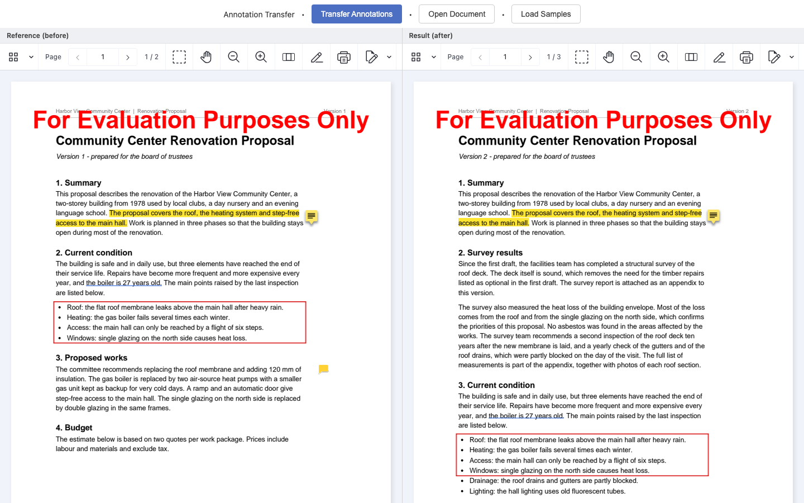
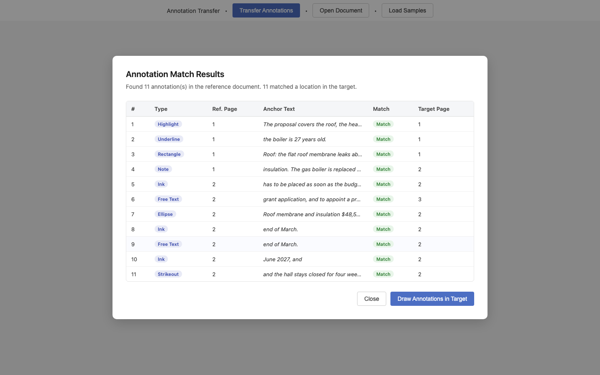
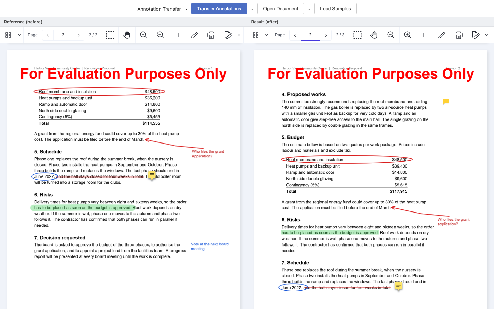

# Nutrient Annotation Transfer

A Nutrient.io demo that moves the annotations of one version of a PDF to the next version of the same document, even when the text has been edited, moved to another section or reflowed onto another page.



1. **Load.** The reference document (the old version, with annotations) and the target document (the new version, without them) are opened by the Nutrient Web SDK in hidden viewers.
2. **Index.** Both documents are read word by word with `textLinesForPageIndex()`. Every word keeps its page, line and position, and a trigram index makes candidate positions quick to find.
3. **Anchor.** Each annotation of the reference is attached to the words it refers to:
   - highlight, underline, strikeout, squiggle and redaction: the words under the markup;
   - rectangle, ellipse, polygon and closed ink strokes: the words inside the shape;
   - ink arrows: the words at the tip of the arrow;
   - wide ink strokes painted over a line (highlighter pen): the words under the stroke;
   - notes and free text: the nearest block of text, or the anchor of the arrow they label.
4. **Match.** The anchor words are searched in the target with a fuzzy local alignment (Smith-Waterman style), so inserted or changed words do not break the match. The 12 words before and after the anchor decide between repeated occurrences of the same text.
5. **Rebuild.** Each annotation is recreated in the target at its new place. Text markup gets exact glyph rectangles from `instance.search()`, and is split into one annotation per page when the text now runs over a page break. Shapes keep their position relative to their text. Ink strokes are moved, not redrawn.
6. **Review.** A results table lists every annotation with its anchor text and where it was matched. **Draw Annotations in Target** writes them and shows the old and the new version side by side.

Everything runs in the browser. The documents are not sent to a server.

## Prerequisites

- Node.js 20 or later and npm
- Internet access: the Web SDK is loaded from the Nutrient CDN (`cdn.cloud.pspdfkit.com`)
- To regenerate the sample documents only: Python 3.9 or later with `reportlab` and `pypdf`

## Environment variables

Copy `.env.example` to `.env`. Vite reads it at build time. The license key is only read from the environment, never from code.

| Variable | Purpose | Default |
|---|---|---|
| `VITE_NUTRIENT_LICENSE_KEY` | Nutrient Web SDK license key | empty = evaluation mode |
| `PORT` | Port of the development server | `5181` |

In evaluation mode the viewer shows an evaluation watermark on every page. Everything else works.

## Build and run

```bash
npm install
```

```bash
cp .env.example .env
```

```bash
npm run dev
```

Open <http://localhost:5181>.

To build a static version in `dist/` and serve it locally:

```bash
npm run build
```

```bash
npm run preview
```

## Using the app

1. Click **Load Samples**. The two sample documents are selected: `proposal-v1-annotated.pdf` (reference) and `proposal-v2.pdf` (target). You can also click **Transfer Annotations** and drop your own two PDFs.
2. Click **Analyze Annotations**. The results table shows each annotation, its type, the anchor text found in the reference, and the page it was matched to in the target. **Page match** means that no anchor text was found and the annotation keeps its position on the most similar page.

   

3. Click **Draw Annotations in Target**. The reference is shown on the left and the target, with the transferred annotations, on the right. The result is exported and reloaded, so it shows what the saved PDF contains.
4. Page through both documents. Use the export button of the right viewer to download the annotated new version.

   

**Open Document** opens a single PDF in the viewer, to check a document before you transfer annotations.

## Sample documents

The samples are fictitious and generated by `tools/generate_samples.py`. Version 1 carries 11 reviewer annotations of 8 types, including three kinds of ink strokes (arrow, circle, highlighter band). Version 2 changes the text so that each kind of change is covered:

| Change in version 2 | Annotation that has to follow it |
|---|---|
| New section inserted after the summary, text reflows | Underline, rectangle around the bullet list |
| Bullets added to the list | Rectangle keeps enclosing the original four items |
| Words inserted and changed in a paragraph that moves to page 2 | Sticky note |
| Budget section moves down the page, other amounts change | Ellipse around the roof line, arrow and its free text label |
| Risks and Schedule sections swapped | Highlighter band, ink circle, strikeout |
| Last section moved to page 3 | Free text comment in the margin |

To regenerate them:

```bash
python3 -m venv .venv
```

```bash
.venv/bin/pip install reportlab pypdf
```

```bash
.venv/bin/python tools/generate_samples.py
```

## Limits

- Anchors are text. Annotations on pages without a text layer (scans without OCR) fall back to their position on the most similar page.
- When the annotated text is deleted from the new version, the annotation also falls back to its page position and is flagged **Page match**.
- Form fields (widgets) are not transferred: they belong to the form, not to the review.

## Files

| Path | Content |
|---|---|
| `index.html` | Application shell, dialogs and the Web SDK script tag |
| `src/main.js` | Viewers, file selection, analysis and drawing flow |
| `src/annotation-matcher.js` | Word index, anchoring, fuzzy matching and rebuilding of the annotations |
| `src/style.css` | Styling |
| `public/samples/` | The two generated sample documents |
| `tools/generate_samples.py` | Generator of the sample documents |
